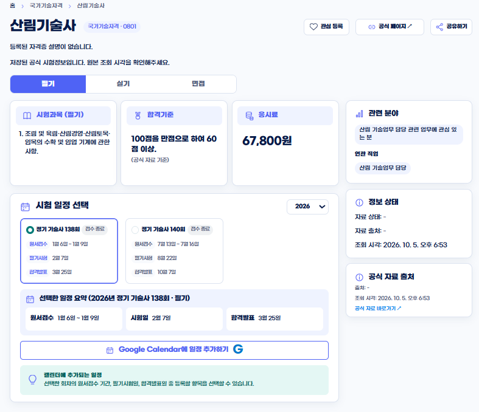
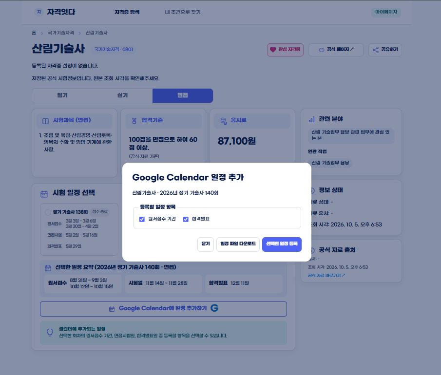
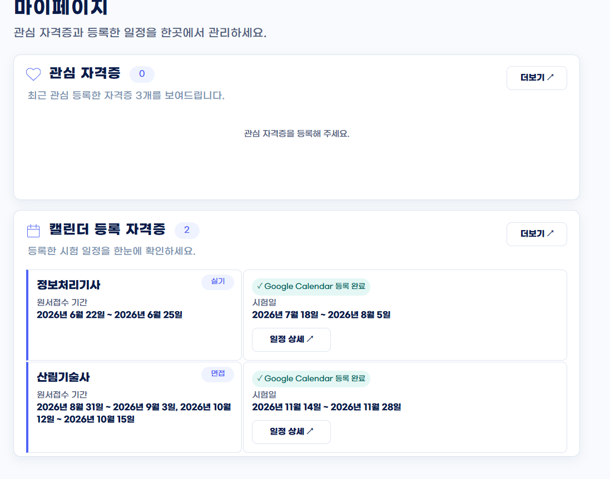
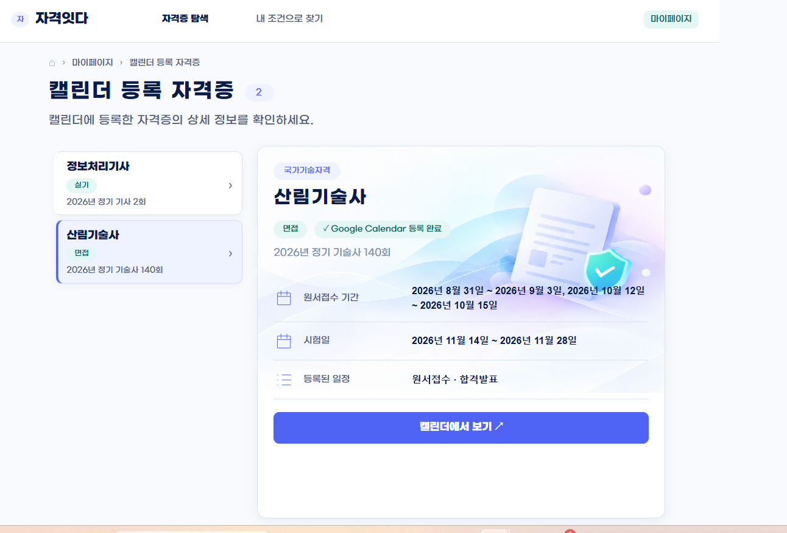

  
  <h1>자격있다</h1>
  
<strong>내 조건에 맞는 국가자격증을 찾고, 시험 준비 일정을 한곳에서 관리하세요.</strong>

  
공식 정보 기반 탐색 · 맞춤 추천 · 시험 일정 · Google Calendar

  

    
    
    
  

---

##  서비스 소개

**자격있다**는 자격증을 검색하는 데서 끝나지 않고, 관심 분야와 프로필을 바탕으로 후보를 살펴본 뒤 공식 시험 정보와 일정을 이어서 확인할 수 있도록 돕는 웹 서비스입니다.

자격증·시험 정보는 별도 백엔드 API에서 받아오며, 추천은 백엔드의 추천 처리와 연결됩니다. 실제로 표시되는 정보는 백엔드 DB 적용 상태와 종목별 수집 자료에 따라 달라질 수 있습니다.

##  주요 기능

| 기능 | 설명 |
| --- | --- |
| 자격증 탐색 | 자격증명과 분야를 검색하고 후보를 살펴봅니다. |
| 맞춤 추천 | 관심 분야, 학력, 전공, 경력 정보를 추천 요청에 포함해 후보와 추천 이유를 확인합니다. |
| 상세 정보 | 시험 과목, 합격 기준, 응시료, 회차별 일정과 공식 출처를 확인합니다. |
| 관심 자격증 | 관심 자격증을 저장해 마이페이지에서 다시 확인합니다. |
| Calendar 등록 | 시험 일정 중 원하는 항목을 선택하고 Google Calendar에 등록합니다. |

##  주요 화면

탐색한 자격증의 공식 정보를 확인하고, 필요한 시험 일정을 선택해 Calendar에 등록한 뒤 마이페이지에서 다시 확인하는 흐름입니다.

<table>
  <tr>
    <td width="50%" align="center">
      
      <strong>자격증 상세</strong> · 시험 단계, 과목, 합격 기준, 응시료, 관련 분야와 회차 일정을 한 화면에서 확인합니다.
    </td>
    <td width="50%" align="center">
      
      <strong>일정 선택</strong> · 원서접수 기간, 시험일, 합격 발표 등 등록할 항목을 선택합니다.
    </td>
  </tr>
  <tr>
    <td width="50%" align="center">
      
      <strong>마이페이지</strong> · 관심 자격증과 Calendar에 등록한 시험 일정을 모아봅니다.
    </td>
    <td width="50%" align="center">
      
      <strong>등록 일정 상세</strong> · 자격증, 회차, 시험 단계, 일정 종류와 등록 상태를 확인합니다.
    </td>
  </tr>
</table>

##  사용 흐름

~~~mermaid
flowchart LR
    A[자격증 탐색] --> B[관심 분야·프로필 입력]
    B --> C[맞춤 추천]
    C --> D[자격증 상세·공식 정보 확인]
    D --> E[시험 회차와 일정 선택]
    E --> F[Google Calendar 권한 동의]
    F --> G[선택한 일정 등록]
~~~

##  아키텍처

~~~mermaid
flowchart LR
    U[사용자] --> FE[React 프론트엔드]
    FE -->|REST API| BE[FastAPI 백엔드]
    BE -->|자격증·시험 정보 조회| DB[(PostgreSQL)]
    BE -->|추천 요청| AG[추천 Agent]
    AG -->|조회 도구 실행| DB
    AG -->|추천 판단| AI[OpenAI API]
    BE -->|사용자 동의 후 일정 생성| GC[Google Calendar]
~~~

이 저장소는 **프론트엔드**를 관리합니다. FastAPI 백엔드와 PostgreSQL은 별도로 운영됩니다. 추천 과정에서 LLM은 DB에 직접 접속하지 않고, 백엔드가 제공하는 조회 도구와 API를 통해 자료를 사용합니다.

##  엔티티 관계도

아래 ERD는 백엔드의 `backend/db/*.sql`에 정의된 테이블과 외래 키를 요약한 것입니다. 이는 SQL 정의 기준이며, Render 운영 DB에 각 SQL이 실제 적용됐는지를 보증하지 않습니다. 특히 Calendar 테이블은 별도 SQL 파일로 관리되므로 운영 DB 적용 상태를 따로 확인해야 합니다.

~~~mermaid
erDiagram
    USERS {
        uuid id PK
        text provider
        text provider_subject_id UK
    }
    USER_PROFILES {
        uuid user_id PK, FK
        text education_level
        text major
        jsonb career_history
    }
    CERTIFICATES {
        uuid id PK
        text qnet_code UK
        text name
        text category
    }
    SCHEDULES {
        uuid id PK
        uuid certificate_id FK
        smallint year
        text round_key
        text phase
    }
    EXAM_INFORMATION {
        uuid certificate_id PK, FK
        jsonb subjects
        jsonb pass_criteria
        jsonb fees
    }
    SOURCES {
        text source_key PK
        timestamptz retrieved_at PK
        uuid certificate_id FK
        text kind
    }
    RECOMMENDATION_INTEREST_CATEGORIES {
        text code PK
        jsonb payload
    }
    CERTIFICATE_RECOMMENDATION_CONTEXTS {
        uuid certificate_id PK, FK
        text qnet_code UK, FK
        jsonb payload
    }
    CALENDAR_CONNECTIONS {
        uuid id PK
        text session_token_hash UK
        timestamptz expires_at
    }
    CALENDAR_EXAM_PLANS {
        uuid id PK
        uuid calendar_connection_id FK
        uuid certificate_id FK
        smallint year
        text round_key
    }
    CALENDAR_REGISTRATIONS {
        uuid id PK
        uuid calendar_connection_id FK
        uuid exam_plan_id FK
        uuid idempotency_key
    }
    CALENDAR_EVENTS {
        uuid id PK
        uuid exam_plan_id FK
        uuid registration_id FK
        uuid schedule_id FK
        uuid certificate_id FK
        text google_event_id UK
    }

    USERS ||--o| USER_PROFILES : "legacy schema"
    CERTIFICATES ||--o{ SCHEDULES : has
    CERTIFICATES ||--o| EXAM_INFORMATION : has
    CERTIFICATES ||--o| CERTIFICATE_RECOMMENDATION_CONTEXTS : has
    CERTIFICATES |o--o{ SOURCES : collected
    CALENDAR_CONNECTIONS ||--o{ CALENDAR_EXAM_PLANS : authorizes
    CERTIFICATES ||--o{ CALENDAR_EXAM_PLANS : selected
    CALENDAR_EXAM_PLANS ||--o{ CALENDAR_REGISTRATIONS : records
    CALENDAR_CONNECTIONS ||--o{ CALENDAR_REGISTRATIONS : authorizes
    CALENDAR_EXAM_PLANS ||--o{ CALENDAR_EVENTS : creates
    CALENDAR_REGISTRATIONS ||--o{ CALENDAR_EVENTS : contains
    CALENDAR_CONNECTIONS ||--o{ CALENDAR_EVENTS : authorizes
    CERTIFICATES ||--o{ CALENDAR_EVENTS : references
    SCHEDULES ||--o{ CALENDAR_EVENTS : references
~~~

- `RECOMMENDATION_INTEREST_CATEGORIES`는 서비스의 관심 분야 선택지이며, 자격증에 고정 연결된 분류표가 아니어서 독립 테이블로 표시했습니다.
- `USERS`와 `USER_PROFILES`는 기존 SQL에 남아 있는 레거시 정의입니다. 현재 무로그인 흐름에서는 프로필을 브라우저에 저장하고 추천 요청에 전달하며, 앱 계정을 만들지 않습니다.
- Calendar 연결은 앱 계정과 분리된 Google 권한 연결입니다. 이 ERD의 관계는 소스 SQL에 선언된 외래 키를 나타냅니다.

##  기술 구성

- **Frontend:** React 19, TypeScript 5, Vite 7
- **Backend:** FastAPI (별도 저장소/서비스)
- **Data:** PostgreSQL, Q-Net 공식 자료 연동
- **Recommendation:** LangGraph 기반 추천 처리, OpenAI API
- **Calendar:** Google OAuth 동의 후 Google Calendar API 사용

##  로컬 실행

### 1. 프론트엔드 준비

~~~bash
git clone https://github.com/munchkin112/Q-net-only_me.git
cd Q-net-only_me
npm install
~~~

프로젝트 루트에 `.env` 파일을 만들고 로컬 백엔드 주소를 설정합니다.

~~~env
VITE_API_BASE_URL=http://127.0.0.1:8000
~~~

`.env`는 로컬 설정용입니다. 실제 키나 비밀번호를 GitHub에 올리지 마세요.

### 2. 서버 실행

백엔드 저장소 루트에서 백엔드 서버를 먼저 실행한 뒤, 프론트엔드 저장소에서 다음 명령을 실행합니다.

~~~bash
npm run dev
~~~

브라우저에서 [http://localhost:5500/home.html](http://localhost:5500/home.html)을 엽니다. `.env` 값을 바꾼 뒤에는 Vite 개발 서버를 다시 시작해야 합니다.

### 3. 빌드 확인

~~~bash
npm run build
~~~

TypeScript 검사 후 배포용 프론트엔드 파일을 생성합니다.

##  Google Calendar 연결 안내

Calendar 연결은 서비스 로그인과 별도의 Google 권한 동의 흐름을 사용합니다. 등록할 일정 종류를 선택한 뒤 Google Calendar 접근을 허용하면, 백엔드가 선택한 시험 일정을 등록합니다.

로컬에서 연결하려면 프론트 주소, 백엔드의 허용 Origin, Google OAuth의 redirect URI가 서로 맞아야 합니다. 현재 프론트 개발 주소는 `http://localhost:5500`이며, 백엔드와 Google Cloud 설정은 각 환경에서 별도로 관리합니다.

##  브라우저에 저장되는 정보

프로필, 추천 결과, 관심 자격증과 화면에 표시하는 일부 등록 이력은 브라우저 저장소에 보관됩니다. 브라우저 저장소를 지우면 이 화면 정보도 초기화될 수 있습니다. 실제 Google Calendar 일정과 서버에 저장되는 연동 정보는 브라우저 화면 상태와 별개입니다.

##  프로젝트 구조

~~~text
src/
├── api/          # 백엔드 API와 Calendar 연동
├── components/   # 공통 UI 요소
├── pages/        # 홈, 프로필, 추천, 상세, 마이페이지
├── styles/       # 화면별 스타일
├── App.tsx       # 화면 상태와 페이지 전환
└── main.tsx      # React 앱 시작점
public/assets/    # 이미지, 아이콘, 폰트
~~~

---

  공식 정보를 더 쉽게 찾고, 다음 시험 일정까지 놓치지 않도록.

