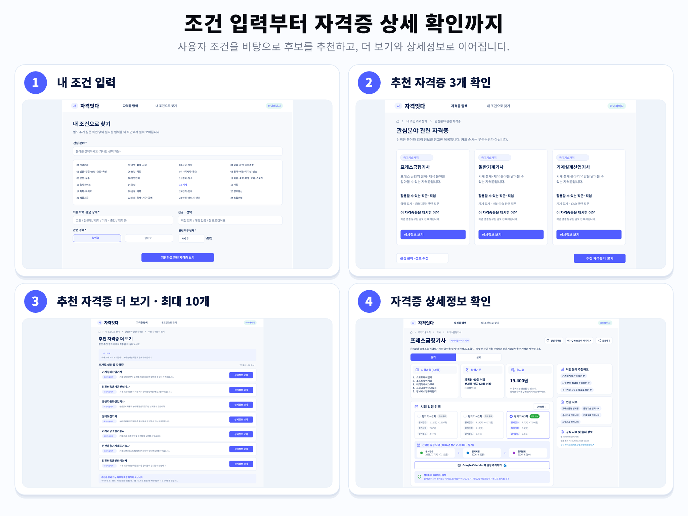
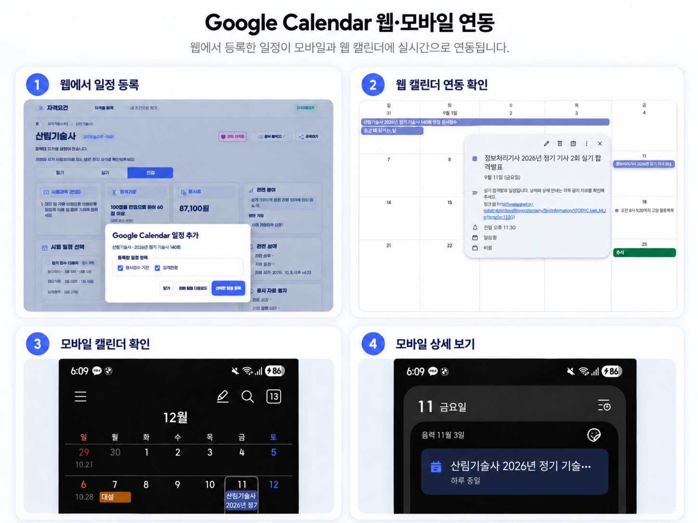
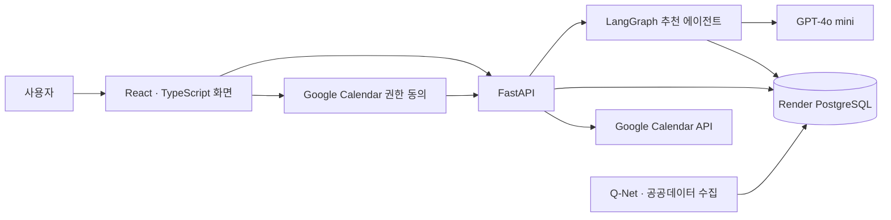

<div align="center">
  
  <h1>자격잇다</h1>
  <p><strong>자격증 탐색부터 시험 일정 관리까지, 준비 과정을 이어주는 서비스</strong></p>
  <p>공식 정보 기반 탐색 · 관심 분야와 사용자 조건 기반 추천 · Google Calendar</p>
</div>

<p align="center">
  <a href="https://docs.google.com/spreadsheets/d/1brT3K545SXhbJ1fCN5n7Us0mg060ppBf7W0hdRXNsgU/edit?gid=0#gid=0">사용자 요구사항 정의서</a> ·
  <a href="https://github.com/munchkin112/Q-Net-Backend/blob/dev/docs/API_설계서.md">API 설계서</a> ·
  <a href="./docs/자격잇다-에이전트-아키텍처-설계.md">아키텍처 설계서</a> ·
  <a href="https://docs.google.com/spreadsheets/d/1brT3K545SXhbJ1fCN5n7Us0mg060ppBf7W0hdRXNsgU/edit?gid=411373342#gid=411373342">자동화 범위</a>
</p>

> 이 저장소는 팀 프로젝트를 바탕으로 개인적으로 관리하는 **React 프론트엔드와 프로젝트 산출물**입니다. FastAPI 백엔드는 [Q-Net-Backend](https://github.com/munchkin112/Q-Net-Backend/tree/dev)에서 별도로 관리합니다. 프로젝트 설명은 [팀 대표 저장소](https://github.com/encore-ai-campus/aio-02-p2-team1)를 기준으로 정리했습니다.

## 목차

1. [프로젝트 소개](#1-프로젝트-소개)
2. [주요 기능](#2-주요-기능)
3. [주요 화면 한눈에 보기](#3-주요-화면-한눈에-보기)
4. [서비스 이용 흐름](#4-서비스-이용-흐름)
5. [시스템 아키텍처](#5-시스템-아키텍처)
6. [기술 스택](#6-기술-스택)
7. [데이터베이스 설계](#7-데이터베이스-설계)
8. [테스트 및 검증](#8-테스트-및-검증)
9. [실행 방법](#9-실행-방법)
10. [팀 구성 및 역할](#10-팀-구성-및-역할)

---

## 1. 프로젝트 소개

자격증을 준비할 때는 자신의 관심 분야와 조건에 맞는 종목을 찾고, 시험정보와 일정을 확인한 뒤 개인 일정까지 옮겨야 합니다. **자격잇다**는 이 과정을 하나의 서비스 흐름으로 연결합니다.

### 문제와 기대효과

| 문제 | 자격잇다를 통해 기대하는 효과 |
| --- | --- |
| 관심 분야와 학력·경력 조건을 고려해 어떤 자격증을 탐색할지 정하기 어렵다 | 입력한 조건을 바탕으로 관련 자격증 후보와 추천 이유를 확인할 수 있다 |
| 상세정보와 시험 일정을 여러 곳에서 따로 확인해야 한다 | 자격증 정보와 회차별 시험 일정을 이어서 살펴볼 수 있다 |
| 확인한 시험 일정을 개인 캘린더에 다시 입력해야 한다 | 선택한 일정 항목을 Google Calendar에 등록하고 결과를 확인할 수 있다 |

**타깃 사용자:** 관심 분야에 맞는 자격증을 찾고 싶은 사람, 자신의 학력·경력 조건을 참고해 후보를 탐색하려는 사람, 시험 일정을 개인 캘린더에서 관리하려는 사람입니다. 추천은 탐색을 돕는 정보이며 공식 응시 자격의 확정 판정은 제공하지 않습니다.

## 2. 주요 기능

| 기능 | 사용자가 할 수 있는 일 |
| --- | --- |
| 자격증 검색 | Q-Net 공식 종목명·코드와 분류로 자격증을 찾습니다. |
| 조건 입력과 추천 | 관심 분야, 학력·졸업 상태, 전공, 경력 여부·기간을 입력해 관련 자격증을 추천받습니다. |
| 추천 근거 확인 | 추천 이유와 검토된 연관 직무·출처를 살펴봅니다. 처음에는 최대 3개를 보여주고, 더보기에서 같은 결과를 펼칩니다. |
| 상세정보·시험 일정 조회 | 종목별 설명, 수집된 시험과목·합격기준·응시료와 연도·회차별 일정을 확인합니다. |
| Google Calendar 등록 | 선택한 시험 회차와 일정 종류에 대해 Calendar 권한을 동의하고 등록 결과를 확인합니다. |
| 일정 파일 다운로드 | 선택한 시험 일정의 `.ics` 파일을 내려받습니다. |
| 관심 자격증·마이페이지 | 관심 자격증과 Calendar 등록 내역을 모아보고 일정 상세로 이동합니다. |

자료가 수집되지 않은 종목이나 일정은 확인 필요 상태로 구분합니다. 추천 카드의 순서는 공식 자격증 순위나 취업 가능성 순위가 아닙니다.

## 3. 주요 화면 한눈에 보기

팀의 조건 입력·추천·상세 조회와 Google Calendar 웹·모바일 연동 화면입니다. 날짜와 수집 상태는 촬영 당시의 예시입니다.





<details>
<summary><strong>개인 버전의 상세·등록·마이페이지 시연 화면</strong></summary>

<table>
  <tr>
    <td width="50%" align="center">
      
      <sub><strong>자격증 상세</strong> · 시험 단계, 과목, 합격 기준, 응시료, 관련 분야와 회차 일정을 한 화면에서 확인합니다.</sub>
    </td>
    <td width="50%" align="center">
      
      <sub><strong>일정 선택</strong> · 원서접수 기간, 시험일, 합격 발표 등 등록할 항목을 선택합니다.</sub>
    </td>
  </tr>
  <tr>
    <td width="50%" align="center">
      
      <sub><strong>마이페이지</strong> · 관심 자격증과 Calendar에 등록한 시험 일정을 모아봅니다.</sub>
    </td>
    <td width="50%" align="center">
      
      <sub><strong>등록 일정 상세</strong> · 자격증, 회차, 시험 단계, 일정 종류와 등록 상태를 확인합니다.</sub>
    </td>
  </tr>
</table>

</details>

## 4. 서비스 이용 흐름

1. 사용자가 관심 분야와 학력·경력 등의 조건을 입력합니다.
2. AI 추천 에이전트가 저장된 공식 자료에서 관련 자격증 후보를 찾고, 검증된 추천 결과를 보여줍니다.
3. 사용자가 자격증 상세정보와 시험 연도·회차를 확인합니다.
4. 등록할 접수·시험·합격발표 항목을 선택합니다.
5. 필요한 경우 Google Calendar 권한에 동의하고 일정을 등록합니다.
6. 마이페이지에서 관심 자격증과 등록 일정을 모아보고, 실제 Google Calendar 일정과 공식 출처 링크를 확인합니다.

일반 자격증 탐색과 추천에는 서비스 계정 로그인이 필요하지 않습니다. Google 동의는 Calendar에 일정을 등록할 때 별도로 진행합니다.

프로필, 마지막 추천 결과, 관심 자격증과 일부 화면 상태는 브라우저 저장소에 보관됩니다. 브라우저 저장소를 지우면 해당 화면 정보는 초기화될 수 있지만, Google Calendar에 생성된 일정이나 서버의 Calendar 연동 데이터와는 별개입니다.

## 5. 시스템 아키텍처



Q-Net·공공데이터 자료를 수집·정리해 PostgreSQL에 보관하고, 화면과 추천 에이전트는 이 저장 자료를 조회합니다. 추천 에이전트가 사용자의 화면 요청마다 Q-Net 외부 API를 직접 호출하는 방식은 아닙니다. Calendar 일정 생성은 추천 에이전트의 도구가 아니라 별도의 등록 API가 처리합니다.

추천 요청은 브라우저의 프로필 값을 본문에 담아 보내며 서버의 사용자 계정 프로필로 저장하지 않습니다.

### 추천 처리와 도구의 역할

- **LLM:** 관심 분야·입력 프로필과 공식 직무 근거를 비교하고, 조회 도구를 선택하거나 추천 이유를 작성합니다.
- **Python 도구:** 실제 DB 조회를 수행하고 결과를 같은 호출 ID의 `ToolMessage`로 전달합니다. LLM이 DB에 직접 접속하지 않습니다.
- **LangGraph:** 요청별 `State`에 프로필·메시지·후보·오류·호출 횟수를 보관하고, 조건 분기로 도구 실행·검증·수정·오류 종료를 연결합니다.
- **Calendar API:** 사용자가 선택하고 동의한 일정의 등록을 담당합니다. 추천 에이전트와 독립된 흐름입니다.

팀의 전체 시스템 구성도, LangGraph 흐름도, Calendar 등록 흐름도와 향후 멀티에이전트 확장안은 [아키텍처 설계서](./docs/자격잇다-에이전트-아키텍처-설계.md)에서 확인할 수 있습니다. 원본 설계도에 포함된 제안과 현재 구현의 차이도 함께 정리했습니다. 단계별 자동 처리와 사용자 선택의 경계는 [개인 버전 자동화 범위 보완 설명](./docs/automation-scope.md)에 정리했습니다.

## 6. 기술 스택

| 영역 | 기술·서비스 | 역할 |
| --- | --- | --- |
| 프론트엔드 | React 19, TypeScript 5, Vite 7 | 입력·검색·추천·상세·Calendar 등록 화면 |
| 백엔드 | Python, FastAPI, Pydantic | API와 입력·응답 검증 |
| 추천 에이전트 | LangGraph, LangChain, GPT-4o mini | 도구 선택, 후보 탐색, 추천 결과 구성 |
| 데이터베이스 | Render PostgreSQL, psycopg | 자격증·시험정보·추천 근거·Calendar 등록 결과 보관 |
| 외부 서비스 | Q-Net·공공데이터 API, Google Calendar API | 공식 자료 수집, 선택한 일정 등록 |

## 7. 데이터베이스 설계

| 데이터 묶음 | 주요 테이블 | 용도 |
| --- | --- | --- |
| 자격증·시험정보 | `certificates`, `exam_information`, `schedules` | 공식 종목, 시험 상세, 회차·단계별 일정 |
| 수집 출처 | `sources` | 공식 원문·수집 결과와 조회 시각 |
| 추천 자료 | `recommendation_interest_categories`, `certificate_recommendation_contexts` | 관심 분야 선택지와 검토된 추천 근거 |
| Calendar 연결·등록 | `calendar_connections`, `calendar_exam_plans`, `calendar_registrations`, `calendar_events` | Calendar 전용 권한 연결, 등록 요청과 이벤트 결과 |

실제 DB의 테이블 적용 상태는 연결 대상에 따라 다릅니다. `GET /health/database`로 접속과 필수 테이블 존재 여부를 확인할 수 있습니다. 아래 ERD는 [백엔드 SQL 정의](https://github.com/munchkin112/Q-Net-Backend/tree/dev/backend/db)의 주요 컬럼과 외래 키를 요약한 것으로, 특정 운영 DB의 적용 상태를 보증하지 않습니다.

<details>
<summary><strong>엔티티 관계도 펼치기</strong></summary>

~~~mermaid
erDiagram
    USERS {
        uuid id PK
        text provider
        text provider_subject_id
    }
    USER_PROFILES {
        uuid user_id PK, FK
        text education_level
        text major
        jsonb career_history
    }
    CERTIFICATES {
        uuid id PK
        text qnet_code UK
        text name
        text category
    }
    SCHEDULES {
        uuid id PK
        uuid certificate_id FK
        smallint year
        text round_key
        text phase
    }
    EXAM_INFORMATION {
        uuid certificate_id PK, FK
        jsonb subjects
        jsonb pass_criteria
        jsonb fees
    }
    SOURCES {
        text source_key PK
        timestamptz retrieved_at PK
        uuid certificate_id FK
        text kind
    }
    RECOMMENDATION_INTEREST_CATEGORIES {
        text code PK
        jsonb payload
    }
    CERTIFICATE_RECOMMENDATION_CONTEXTS {
        uuid certificate_id PK, FK
        text qnet_code UK, FK
        jsonb payload
    }
    CALENDAR_CONNECTIONS {
        uuid id PK
        text session_token_hash UK
        timestamptz expires_at
    }
    CALENDAR_EXAM_PLANS {
        uuid id PK
        uuid calendar_connection_id FK
        uuid certificate_id FK
        smallint year
        text round_key
    }
    CALENDAR_REGISTRATIONS {
        uuid id PK
        uuid calendar_connection_id FK
        uuid exam_plan_id FK
        uuid idempotency_key
    }
    CALENDAR_EVENTS {
        uuid id PK
        uuid exam_plan_id FK
        uuid registration_id FK
        uuid calendar_connection_id FK
        uuid schedule_id FK
        uuid certificate_id FK
        text google_event_id UK
    }

    USERS ||--o| USER_PROFILES : "legacy schema"
    CERTIFICATES ||--o{ SCHEDULES : has
    CERTIFICATES ||--o| EXAM_INFORMATION : has
    CERTIFICATES ||--o| CERTIFICATE_RECOMMENDATION_CONTEXTS : has
    CERTIFICATES |o--o{ SOURCES : collected
    CALENDAR_CONNECTIONS ||--o{ CALENDAR_EXAM_PLANS : authorizes
    CERTIFICATES ||--o{ CALENDAR_EXAM_PLANS : selected
    CALENDAR_EXAM_PLANS ||--o{ CALENDAR_REGISTRATIONS : records
    CALENDAR_CONNECTIONS ||--o{ CALENDAR_REGISTRATIONS : authorizes
    CALENDAR_EXAM_PLANS ||--o{ CALENDAR_EVENTS : creates
    CALENDAR_REGISTRATIONS ||--o{ CALENDAR_EVENTS : contains
    CALENDAR_CONNECTIONS ||--o{ CALENDAR_EVENTS : authorizes
    CERTIFICATES ||--o{ CALENDAR_EVENTS : references
    SCHEDULES ||--o{ CALENDAR_EVENTS : references
~~~

</details>

- `recommendation_interest_categories`는 서비스 관심 선택지이며 자격증별 고정 분류표가 아니므로 독립 테이블로 표시했습니다.
- `users`·`user_profiles`는 초기 로그인 구조의 레거시 정의입니다. 현재 무로그인 추천 흐름은 이 테이블에 프로필을 저장하지 않습니다.
- `users`의 고유 조건은 `(provider, provider_subject_id)` 조합입니다. Calendar 등록 요청은 `(calendar_connection_id, idempotency_key)`로 식별하며, 이벤트의 중복 기준은 별도 SQL 제약으로 관리합니다.
- Calendar 연결은 앱 계정과 분리되어 있습니다. SQL이나 마이그레이션을 적용하기 전에는 연결 대상 DB와 기존 적용 상태를 확인해야 합니다.

## 8. 테스트 및 검증

아래는 팀 README에 기록된 검증 결과입니다. 개별 실행 환경과 코드 버전의 범위로 해석하며, 이번 문서 통합에서 재측정한 수치는 아닙니다.

| 범위 | 확인된 결과 | 해석 범위 |
| --- | --- | --- |
| 추천 에이전트 자동 테스트 | 2026-10-13 로컬 백엔드에서 관련 테스트 43개 통과 | 별도로 확인한 로컬 `dev` 코드에서 모델·도구·외부 의존성을 모의 처리한 검사. 최종 통합본의 규칙 기반 추천 분기 검증 여부는 별도 확인 필요 |
| 실제 모델·DB 단일 실행 기록 | 합성 프로필 1건에서 추천 3개, 후보·인용 검증 통과 | 반복 평가나 전체 사용자 품질을 뜻하지 않음 |
| 사용자 흐름 통합 시연 | 다른 로컬 환경에서 조건 입력부터 Google Calendar 확인까지 성공한 사례를 팀에서 공유 | 이 README를 작성하면서 같은 환경에서 재실행한 결과는 아님 |

의미적 추천 적합성, 동일 조건 반복 일관성, 사용자군별 완료율, 자가 보완 전후 성능 차이는 아직 충분한 표본으로 측정하지 않았습니다.

## 9. 실행 방법

Python·uv, Node.js·npm, Git이 설치된 환경을 기준으로 합니다. 프론트엔드와 백엔드는 별도 폴더와 터미널에서 실행합니다.

### 백엔드

Windows PowerShell에서 백엔드 `dev` 브랜치를 내려받습니다.

```powershell
git clone --branch dev https://github.com/munchkin112/Q-Net-Backend.git
cd Q-Net-Backend
uv venv
uv pip install -r backend/requirements.txt
if (-not (Test-Path backend/.env)) { Copy-Item backend/.env.example backend/.env }
# backend/.env에 환경별 값을 설정한 다음 실행합니다.
uv run python -m uvicorn backend.main:app --reload --host 127.0.0.1 --port 8000
```

환경변수는 백엔드의 [`.env.example`](https://github.com/munchkin112/Q-Net-Backend/blob/dev/backend/.env.example)을 기준으로 설정합니다.

| 항목 | 설정 기준 |
| --- | --- |
| `DATABASE_URL` | 로컬에서는 Render External Database URL. Render 내부 네트워크 연결이 가능한 백엔드에서는 Internal URL 사용 |
| `OPENAI_API_KEY` | 추천 모델 호출에 사용할 키 |
| `QNET_SERVICE_KEY` | 공식 자료를 수집할 때 사용할 공공데이터 키 |
| `GOOGLE_CLIENT_ID`, `GOOGLE_CLIENT_SECRET` | Calendar 전용 OAuth 웹 클라이언트 |
| `GOOGLE_REDIRECT_URI` | Google Cloud에 등록한 프론트 callback 주소와 정확히 일치. 로컬 예: `http://localhost:5500/calendar-callback.html` |
| `GOOGLE_TOKEN_ENCRYPTION_KEY` | Calendar 갱신 토큰 암호화용 Fernet 키. 기존 저장 토큰이 있다면 같은 키를 유지 |
| `AUTH_ALLOWED_ORIGINS` | 로컬 예: `http://localhost:5500` — 경로와 끝 슬래시 제외 |
| `AUTH_COOKIE_SECURE` | 로컬 HTTP 개발에서는 `false`, HTTPS 배포에서는 `true` |

실제 키·DB 접속 URL은 Git에 올리지 않습니다. DB 초기화·자료 수집·마이그레이션은 서버 실행과 별도이며, 공유 DB를 대상으로 임의 실행하지 않습니다.

### 이 개인 레포의 프론트엔드

새 PowerShell 창에서 실행합니다.

```powershell
git clone https://github.com/munchkin112/Q-net-only_me.git
cd Q-net-only_me
npm install
if (-not (Test-Path .env)) {
    'VITE_API_BASE_URL=http://127.0.0.1:8000' | Set-Content -Encoding utf8 .env
}
npm run dev
```

기존 `.env`가 있으면 `VITE_API_BASE_URL` 값만 확인해 수정합니다. 값을 바꾼 뒤에는 Vite 서버를 다시 실행합니다.

- 서비스 화면: `http://localhost:5500/home.html`
- API 문서: `http://127.0.0.1:8000/docs`
- 서버 상태: `GET /health`
- DB 연결·필수 테이블 상태: `GET /health/database`

배포용 프론트엔드 파일은 다음 명령으로 TypeScript 검사 후 생성합니다.

```powershell
npm run build
```

### 프로젝트 구조

```text
src/
├── api/          # 백엔드 API·Calendar 연동·브라우저 저장소
├── components/   # 공통 UI 요소
├── pages/        # 탐색, 프로필, 추천, 상세, 마이페이지
├── styles/       # 화면별 스타일
├── App.tsx       # 화면 상태와 페이지 전환
└── main.tsx      # React 앱 시작점
docs/
├── readme-cover.png
├── readme-screen-flow-*.png            # 팀 서비스 흐름 화면
├── readme-screenshots/                 # 개인 버전 시연 화면
├── system-architecture.png             # 팀 전체 시스템 설계도
├── langgraph-execution-flow.png        # 팀 추천 흐름 설계도
├── calendar-registration-flow.png      # 팀 Calendar 흐름 설계도
├── multi-agent-expansion.png           # 향후 확장안
├── 자격잇다-에이전트-아키텍처-설계.md
└── automation-scope.md
public/assets/   # 앱에서 사용하는 이미지·아이콘·폰트
```

## 10. 팀 구성 및 역할

| 이름 | 역할 | 담당 영역 | GitHub |
| --- | --- | --- | --- |
| 강민우 | FE 보조  | 와이어프레임 초안 수정 및 문서 점검  | [akfxkfkd135-collab](https://github.com/akfxkfkd135-collab) |
| 박서윤 | 팀장, PM | 문서 정리 및 BE Agent/FE 기능 점검 | [seoyun-park](https://github.com/seoyun-park) |
| 배소정 | FE, 배포 | 화면 구현, Git branch merge, Google Calendar API, DB/API 설계서 | [thwjd9393](https://github.com/thwjd9393) |
| 임익현 | BE | FastAPI API, PostgreSQL 연동, LangGraph 기반 자격증 추천, Google Calendar 연동 및 통합 테스트 | [munchkin112](https://github.com/munchkin112) |

이 개인 레포에는 팀 작업 이후 보완한 관련 직무 표시, 개인 시연 화면, ERD와 실행 안내를 함께 정리했습니다.

---

팀 소개와 설계 산출물의 기준: [aio-02-p2-team1 · 8216e4b](https://github.com/encore-ai-campus/aio-02-p2-team1/tree/8216e4bbbafe49436da47efa41d2afc24693cb0a). 팀 자료를 우선해 중복 설명을 통합하고, 개인 레포의 화면·ERD·실행 안내를 보완했습니다. 대표 이미지·화면 모음·설계도 PNG는 팀 저장소의 원본을 포함합니다.
