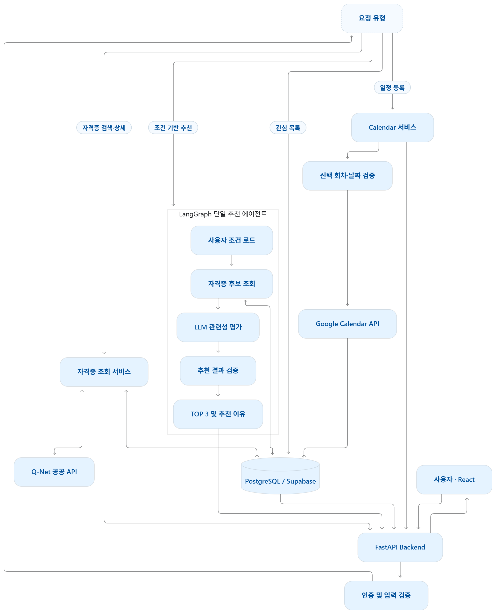
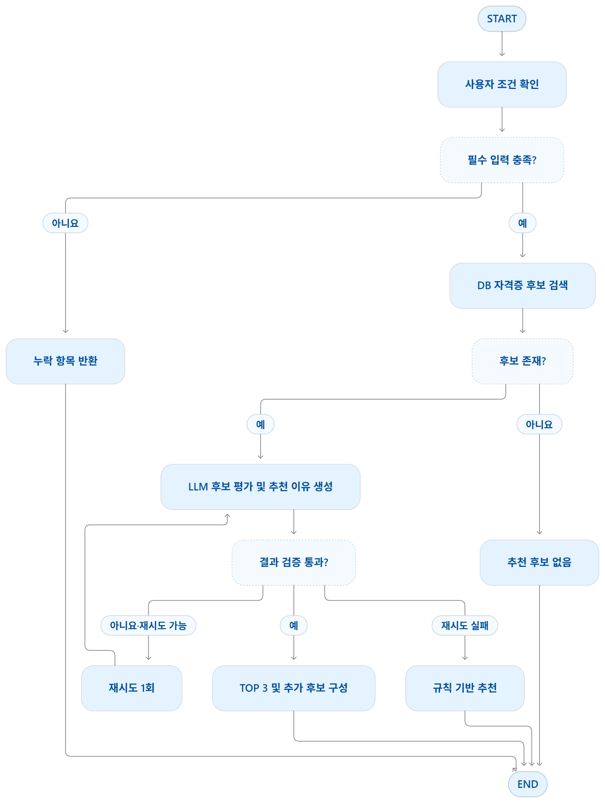
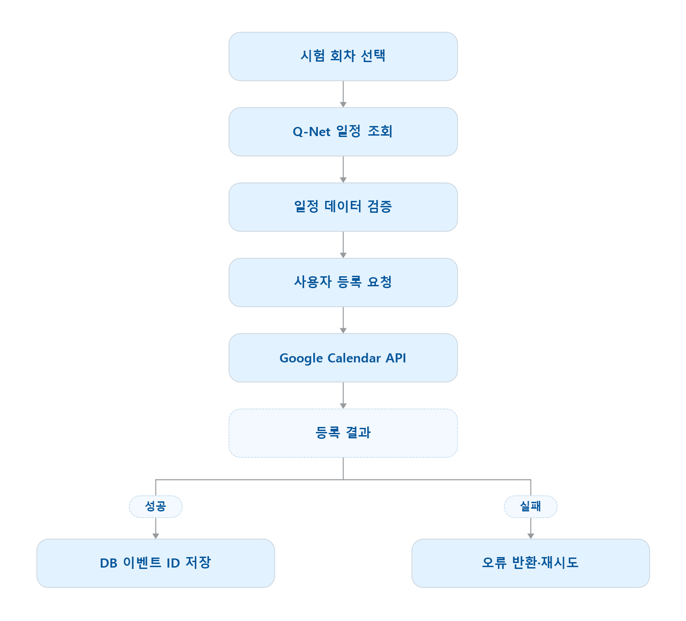
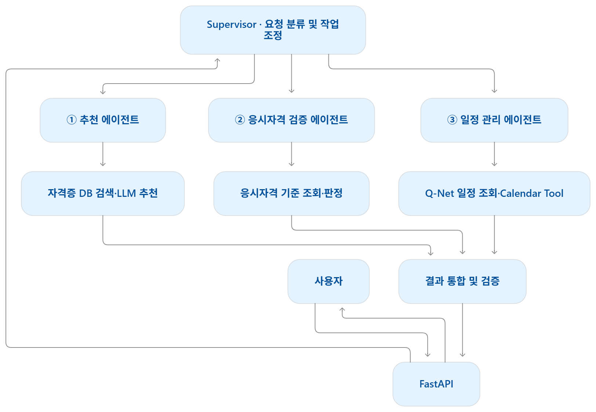

# 자격잇다 — 에이전트 아키텍처 설계

[README로 돌아가기](../README.md) · [API 설계서](https://github.com/munchkin112/Q-Net-Backend/blob/dev/docs/API_설계서.md)

이 문서는 [팀 아키텍처 설계 산출물](https://github.com/encore-ai-campus/aio-02-p2-team1/blob/8216e4bbbafe49436da47efa41d2afc24693cb0a/docs/자격잇다-에이전트-아키텍처-설계.md)을 바탕으로 정리했습니다. 이미지 4종은 원본을 보존하고, 팀 README·백엔드 API 명세와 다르게 읽힐 수 있는 부분에 현재 구현 기준을 덧붙였습니다.

## 1. 전체 시스템과 역할 분리

단일 추천 에이전트가 관심 분야와 사용자 조건을 바탕으로 후보를 평가합니다. FastAPI가 요청을 받고, 실제 DB 조회와 결과 검증은 Python이 수행합니다. Calendar 등록은 별도의 API·서비스가 처리합니다.

### 팀 전체 시스템 설계도

아래는 역할 분리를 설명하는 설계 이미지입니다. 현재 시스템은 **Render PostgreSQL**을 사용하며, 그림의 `PostgreSQL / Supabase` 중 Supabase는 사용하지 않습니다. `Q-Net 공공 API`는 공식 자료 수집 경로를 뜻하며 사용자 화면 요청마다 직접 호출한다는 뜻은 아닙니다.

| 설계도의 표현 | 현재 구현 기준 |
| --- | --- |
| 인증 계층·Google 로그인 | 일반 탐색과 추천에는 앱 로그인이 없습니다. Google 동의는 Calendar 연결에만 사용합니다. |
| 사용자 조건 로드·`get_user_profile` | 프론트가 브라우저에 저장한 프로필을 추천 요청 본문으로 전달합니다. 현재 추천 도구에 서버 프로필 조회는 없습니다. |
| PostgreSQL / Supabase | Render PostgreSQL을 사용합니다. |
| Q-Net 공공 API 조회 | 별도 수집 과정에서 DB에 저장한 공식 자료를 조회합니다. |
| TOP 3 | 전체 추천은 최대 10개이며, 첫 화면에서 최대 3개를 표시합니다. 근거 있는 후보가 적으면 그 수만 반환합니다. |

프로필과 추천 결과의 브라우저 저장은 요청 간 영구 Agent 메모리와 구분합니다. 추천 실행의 `State`는 한 요청 동안의 단기 상태입니다.

## 2. LangGraph 추천 흐름

### 팀 추천 흐름 설계도

이 이미지에는 **검토안인 규칙 기반 fallback**이 포함되어 있습니다. 현재 확인한 백엔드 `dev`의 `fallback`은 `status='failed'`로 종료하며, 검증에 실패한 결과를 규칙 기반 추천으로 바꾸지 않습니다. 따라서 아래 그림의 모든 분기가 구현 완료되었다고 해석하지 않습니다.

### 현재 코드의 Node와 Tool

실제 노드 이름과 연결은 [recommendation_graph.py](https://github.com/munchkin112/Q-Net-Backend/blob/dev/backend/recommendation_graph.py), 모델 실행 설정은 [recommendation_service.py](https://github.com/munchkin112/Q-Net-Backend/blob/dev/backend/recommendation_service.py), 조회 도구는 [recommendation_tools.py](https://github.com/munchkin112/Q-Net-Backend/blob/dev/backend/recommendation_tools.py)를 기준으로 확인합니다.

| 구분 | 이름 | 책임 | LLM 사용 |
| --- | --- | --- | --- |
| Node | `prepare` | 입력을 검증하고 요청별 State·초기 메시지 구성 | 없음 |
| Node | `context` | 메시지 크기, 처리 시간, 모델 호출 한도 검사 | 없음 |
| Node | `decision` | 조회 도구 선택 또는 최종 선정 결과 작성 | 사용 |
| Node | `tools` | 허용한 도구 실행, ToolMessage와 후보 상태 갱신 | 없음 |
| Tool | `list_interest_categories` | 서비스 관심 선택지와 설명 조회 | 없음 |
| Tool | `search_certificates` | 공식 근거를 가진 실제 자격증 후보 조회 | 없음 |
| Node | `validate` | 응답 구조·실제 후보 ID·근거·중복 등을 검증 | 없음 |
| Node | `repair` | 결과·도구 인자 오류를 메시지에 반영해 제한된 수정 요청 | 이후 `decision`에서 사용 |
| Node | `retry` | 재시도 가능한 일시 오류를 제한된 횟수 안에서 재실행 | 대상에 따라 다름 |
| Node | `finish` | 검증한 추천 결과를 반환 | 없음 |
| Node | `fallback` | 해결하지 못한 오류를 실패 상태로 종료 | 없음 |

주요 반복은 `context → decision → tools → context`입니다. 최종 응답이면 `validate`로 이동하고, 검증 결과에 따라 `finish`, `repair`, `fallback`으로 분기합니다. 단순 조건과 횟수 제한은 Python Router가 결정합니다.

`State`에는 프로필, 관심 코드, 메시지, 조회 후보, 실행한 도구, 오류, 호출·수정·재시도 횟수, 결과를 보관합니다. 현재 호출 한도는 모델 5회·도구 6회이며, 일시 오류 재시도와 결과·인자 보완은 각각 최대 1회입니다. 이는 토큰 비용의 고정 상한을 의미하지 않습니다.

LLM은 제공된 실제 `certificate_id`와 문서 ID를 사용해야 합니다. 이름·요약·출처 같은 API 카드 정보는 백엔드 자료를 기준으로 구성하며, 예시 식별자나 LLM이 만든 자격증을 실제 결과로 사용하지 않습니다.

## 3. Google Calendar 연동

사용자가 회차와 일정 항목을 고르고 등록을 요청하면, 필요한 Google 권한 동의를 거쳐 Calendar 서비스가 등록합니다. 추천 에이전트가 자율적으로 Calendar를 변경하지 않습니다.

아래 이미지의 `Q-Net 일정 조회`는 저장된 공식 일정을 조회하는 것으로 읽습니다. 실패 후 재시도 여부는 등록 상태와 오류의 재시도 가능 여부를 확인해 결정합니다.

앱 로그인과 Calendar OAuth는 별개입니다. 로컬 또는 배포 환경에서 프론트 callback 주소, Google Redirect URI, CORS 허용 Origin과 쿠키 설정이 맞아야 합니다. 등록 요청 식별자와 저장된 Google 이벤트 정보를 활용해 중복 등록을 제어합니다.

## 4. 향후 멀티에이전트 확장안

다음 그림은 **미구현 확장안**입니다. 현재 서비스는 단일 추천 에이전트와 독립된 Calendar 서비스로 구성합니다.

| 에이전트 | 확장 시 검토할 역할 |
| --- | --- |
| Supervisor | 요청을 분류하고 전문 에이전트의 작업·결과를 조정 |
| Recommendation Agent | 관심 분야·프로필에 맞는 후보 평가와 추천 이유 생성 |
| Eligibility Agent | 공식 응시요건과 입력 조건 비교. 근거가 부족하면 추가 확인 필요 반환 |
| Schedule Agent | 회차·일정 조회와 등록 요청 처리. 일정 생성·변경은 사용자 승인 후 기존 Calendar 서비스 호출 |

공식 응시자격 확정 판정, 전용 벡터 RAG, 장기 메모리, 시험 준비 로드맵은 이 문서에서 구현 완료 기능으로 설명하지 않습니다. 기능 범위가 늘어날 때 필요성과 운영 비용을 검토하는 후속 설계 자료로 사용합니다.
